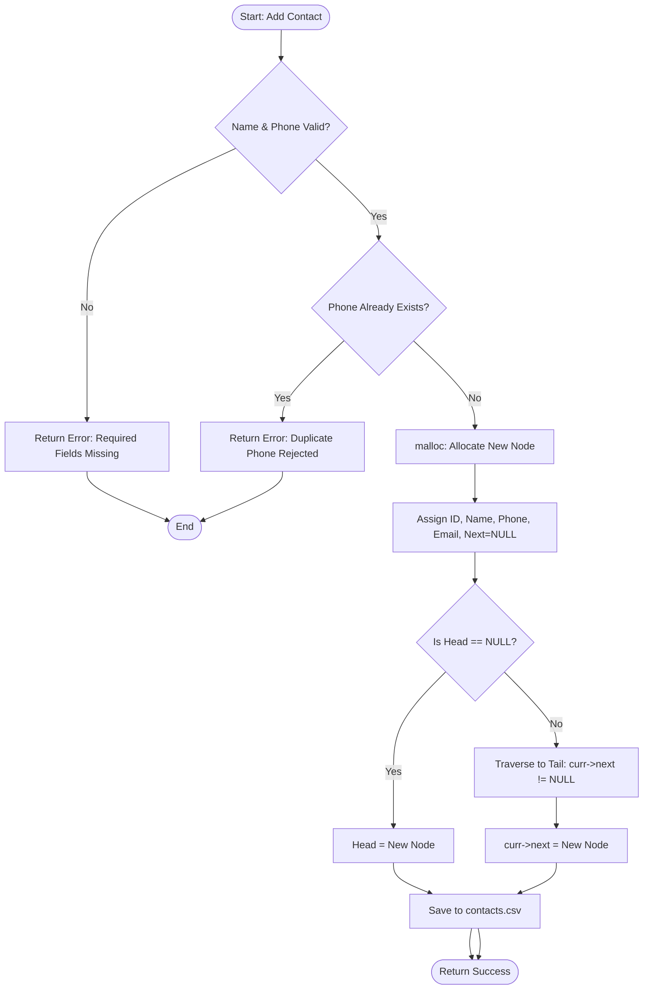

# ACADEMIC PROJECT REPORT

## Contact Management System Using a Dynamic Singly Linked List in C
**Course:** Data Structures & Algorithms Lab  
**Architecture:** C99 Singly Linked List Core + Native POSIX Server + Retro Cyber Terminal GUI  

---

## Table of Contents
1. [Project Title](#1-project-title)
2. [Abstract](#2-abstract)
3. [Problem Statement](#3-problem-statement)
4. [Objectives](#4-objectives)
5. [Software and Hardware Requirements](#5-software-and-hardware-requirements)
6. [Introduction to Linked Lists](#6-introduction-to-linked-lists)
7. [System Architecture](#7-system-architecture)
8. [Node Structure and Memory Representation](#8-node-structure-and-memory-representation)
9. [Algorithms for All Operations](#9-algorithms-for-all-operations)
10. [System Flowcharts](#10-system-flowcharts)
11. [Source Code Explanation](#11-source-code-explanation)
12. [Sample Outputs and Visual Interface](#12-sample-outputs-and-visual-interface)
13. [Time and Space Complexity Analysis](#13-time-and-space-complexity-analysis)
14. [Test Cases and Experimental Verification](#14-test-cases-and-experimental-verification)
15. [Advantages and Limitations](#15-advantages-and-limitations)
16. [Future Enhancements](#16-future-enhancements)
17. [Conclusion](#17-conclusion)

---

## 1. Project Title
**"Design, Implementation, and Analysis of a Persistent Contact Management System Utilizing a Dynamically Allocated Singly Linked List with Dual Interface Architecture in C."**

---

## 2. Abstract
Managing structured records efficiently without relying on static arrays or heavyweight database engines is a fundamental challenge in systems programming and data structure design. This academic project presents a robust Contact Management System (CMS) written in the C programming language that utilizes a **Singly Linked List** as its primary in-memory data structure. 

The application implements full CRUD operations (Create, Read, Update, Delete), linear and case-insensitive searching, duplicate prevention, in-place alphabetical sorting via linked-list Bubble Sort, and non-volatile CSV persistence. To make the project accessible both for technical evaluation and modern user interaction, a dual-interface architecture is provided: an interactive terminal Command Line Interface (CLI), and an integrated lightweight C HTTP server communicating with a responsive, retro cyber terminal Web Graphical User Interface (GUI). All data manipulations occur strictly within dynamically allocated C heap nodes (`malloc` and `free`).

---

## 3. Problem Statement
Traditional contact management applications implemented for academic demonstrations often suffer from one of two pitfalls:
1. **Static Array Allocation:** They use fixed-size static arrays (`struct Contact contacts[100]`), which suffer from internal memory fragmentation, hardcoded capacity limits, and inefficient $O(n)$ element shifting during insertions and deletions.
2. **Fake Data Structures:** Many graphical applications disguise high-level JavaScript arrays or database engines as linked lists, failing to demonstrate genuine dynamic memory management.

There is a clear academic need for an authentic, educational, and production-quality software solution that implements a genuine pointer-based Singly Linked List in C, provides persistent disk storage, handles all edge cases (head deletion, middle deletion, tail deletion, solo node deletion, duplicate validation), and bridges lower-level C memory concepts with an intuitive user interface.

---

## 4. Objectives
- Implement an authentic Singly Linked List in pure C with manual heap management (`malloc` / `free`).
- Prevent memory leaks through rigorous pointer discipline and clean deallocation routines.
- Implement search functionality supporting case-insensitive name matching, exact phone numbers, and unique IDs.
- Enforce business logic constraints: mandatory fields and prevention of duplicate phone numbers.
- Provide in-place alphabetical sorting performed natively on the linked list in C.
- Maintain persistence via structured CSV file input/output (`contacts.csv`).
- Deliver dual interfaces: a CLI for terminal console usage and an HTTP-powered Web GUI with an interactive Heap Memory Inspector.
- Provide comprehensive unit tests covering all operational edge cases.

---

## 5. Software and Hardware Requirements

### Software Requirements
- **Operating System:** Linux (Ubuntu 20.04+, Debian, Fedora, Arch) / macOS / Windows with WSL2 or MinGW.
- **Compiler:** GCC (GNU Compiler Collection) supporting the ISO C99 standard (`-std=c99 -Wall -Wextra -pedantic`).
- **Build Automation:** GNU Make 4.0+.
- **Frontend Presentation:** Any modern web browser (Google Chrome, Mozilla Firefox, Microsoft Edge, Safari) supporting ES6 and CSS Grid.
- **Standard C Libraries:** `<stdio.h>`, `<stdlib.h>`, `<string.h>`, `<strings.h>`, `<ctype.h>`, `<sys/socket.h>`, `<netinet/in.h>`, `<unistd.h>`. (Zero third-party library dependencies).

### Hardware Requirements
- **Processor:** 1.0 GHz x86_64 or ARM processor.
- **RAM:** Minimum 256 MB (Application binary uses < 5 MB virtual memory).
- **Disk Space:** Less than 10 MB total footprint.

---

## 6. Introduction to Linked Lists
In computer science, a **Linked List** is a linear collection of data elements whose order is not given by their physical placement in memory. Instead, each element points to the next. It is a data structure consisting of a collection of **nodes** which together represent a sequence.

### Types of Linked Lists
1. **Singly Linked List (Implemented in this Project):** Each node contains a data payload and a single pointer (`next`) directed towards the subsequent node. The terminal node's pointer is set to `NULL`.
2. **Doubly Linked List:** Each node contains two pointers (`prev` and `next`), allowing bi-directional traversal at the cost of additional pointer memory overhead.
3. **Circular Linked List:** The last node's pointer circles back to the first (`head`) node rather than pointing to `NULL`.

### Why Singly Linked List for Contact Management?
- **Dynamic Sizing:** Memory is allocated node-by-node at runtime via `malloc()`. The list grows and shrinks dynamically to match the user's phonebook size.
- **Efficient Deletion & Insertion:** Once a node's location is identified, insertion and deletion require only changing 1 or 2 pointer references, without moving contiguous blocks of memory.
- **Memory Efficiency:** A singly linked list requires only one pointer per record (8 bytes on 64-bit platforms), minimizing overhead compared to trees or doubly linked lists.

---

## 7. System Architecture

The application adopts a modular multi-tier architecture:

```
+-------------------------------------------------------------------+
|                        PRESENTATION LAYER                         |
|   +----------------------------+   +--------------------------+   |
|   |  Interactive Terminal CLI  |   | Modern Web GUI Dashboard |   |
|   |          (cli.c)           |   | (HTML5 / CSS3 / JS ES6)  |   |
|   +-------------+--------------+   +------------+-------------+   |
+-----------------|-------------------------------|-----------------+
                  |                               | HTTP JSON / REST
+-----------------|-------------------------------v-----------------+
|                 |                  C HTTP / REST SERVER           |
|                 |                       (server.c)                |
|                 +---------------+---------------+                 |
+---------------------------------|---------------------------------+
                                  v
+-------------------------------------------------------------------+
|                      DATA STRUCTURE CORE LAYER                    |
|                        (contact.h / contact.c)                    |
|                                                                   |
|   HEAD Pointer ---> [Node 1] ---> [Node 2] ---> [Node 3] -> NULL  |
|                                                                   |
|   Operations: addContact, searchContacts, updateContact,          |
|               deleteContact, sortContacts, freeContacts           |
+---------------------------------+---------------------------------+
                                  |
                                  v
+-------------------------------------------------------------------+
|                       PERSISTENCE STORAGE LAYER                   |
|                        (storage.h / storage.c)                    |
|                                                                   |
|                  Local Disk File: "contacts.csv"                  |
+-------------------------------------------------------------------+
```

---

## 8. Node Structure and Memory Representation

### The C Structure Definition
```c
struct Contact {
    int id;                 /* Unique 4-byte integer identifier */
    char name[50];          /* 50-byte character array for contact name */
    char phone[20];         /* 20-byte character array for phone number */
    char email[60];         /* 60-byte character array for email address */
    struct Contact *next;   /* 8-byte pointer to next node on heap */
};
```

### Memory Footprint & Padding Analysis (64-bit Architecture)
- `int id`: 4 bytes
- *Padding:* 4 bytes (for 8-byte boundary alignment)
- `char name[50]`: 50 bytes
- `char phone[20]`: 20 bytes
- `char email[60]`: 60 bytes
- *Padding:* 2 bytes
- `struct Contact *next`: 8 bytes
- **Total sizeof(struct Contact):** `144 bytes` per contact node.

### Conceptual Heap Memory Layout
```
+-----------------------------------------------------------------------------+
|                                    HEAP                                     |
|                                                                             |
|  [Head: 0x55a100]                                                           |
|         |                                                                   |
|         v                                                                   |
|  +---------------------------+       +---------------------------+          |
|  | Address: 0x55a100         |       | Address: 0x55a240         |          |
|  | id:    1                  |       | id:    2                  |          |
|  | name:  "Aarav Sharma"     |       | name:  "Priya Patel"      |          |
|  | phone: "09820112345"      | ----> | phone: "09819234567"      | ---> ... |
|  | email: "aarav@test.in"    |       | email: "priya@test.in"    |          |
|  | next:  0x55a240           |       | next:  0x55a380           |          |
|  +---------------------------+       +---------------------------+          |
+-----------------------------------------------------------------------------+
```

---

## 9. Algorithms for All Operations

### Algorithm 1: Create Node (`createNode`)
1. **Input:** `id`, `name`, `phone`, `email`.
2. Allocate memory on heap: `newNode = (Contact*)malloc(sizeof(Contact))`.
3. If `newNode == NULL`, output memory allocation error and return `NULL`.
4. Copy `id`, sanitize and copy `name`, `phone`, `email` into `newNode`.
5. Set `newNode->next = NULL`.
6. Return `newNode`.

### Algorithm 2: Add Contact (`addContact`)
1. Validate required fields (`name` and `phone` must not be empty).
2. Check if `phone` exists in list using `isPhoneDuplicate(*head, phone, -1)`. If duplicate, reject and return `0`.
3. Allocate new node: `newNode = createNode(assignedId, name, phone, email)`.
4. If `*head == NULL`, set `*head = newNode` and return `assignedId`.
5. Else, set `current = *head`.
6. Traverse while `current->next != NULL`, moving `current = current->next`.
7. Set `current->next = newNode`.
8. Return `assignedId`.

### Algorithm 3: Delete Contact (`deleteContact`)
1. If `*head == NULL`, return `0` (List empty).
2. Check if the target is the first node: if `(*head)->id == id`:
   - Set `temp = *head`.
   - Update `*head = (*head)->next`.
   - Call `free(temp)`.
   - Return `1` (Success).
3. Initialize `prev = *head` and `curr = (*head)->next`.
4. Loop while `curr != NULL` and `curr->id != id`:
   - `prev = curr`.
   - `curr = curr->next`.
5. If `curr == NULL`, return `0` (Contact not found).
6. Unlink node: `prev->next = curr->next`.
7. Deallocate memory: `free(curr)`.
8. Return `1` (Success).

### Algorithm 4: Search Contacts (`searchContacts`)
1. Input query string $Q$.
2. Initialize `matchCount = 0`, `current = *head`.
3. While `current != NULL` and `matchCount < maxResults`:
   - Convert `current->id` to string.
   - If case-insensitive substring match found in `name`, `phone`, `email`, or ID string:
     - Store `results[matchCount] = current`.
     - Increment `matchCount`.
   - Move `current = current->next`.
4. Return `matchCount`.

### Algorithm 5: Sort Contacts Alphabetically (`sortContacts`)
1. If `*head == NULL` or `(*head)->next == NULL`, return (0 or 1 element is already sorted).
2. Initialize `lptr = NULL` (boundary of sorted elements).
3. Do:
   - Set `swapped = 0`, `ptr1 = *head`.
   - While `ptr1->next != lptr`:
     - Compare `strcasecmp(ptr1->name, ptr1->next->name)`.
     - If `ptr1->name > ptr1->next->name`:
       - Swap payload data (`id`, `name`, `phone`, `email`) between `ptr1` and `ptr1->next`.
       - Set `swapped = 1`.
     - Advance `ptr1 = ptr1->next`.
   - Set `lptr = ptr1`.
4. While `swapped != 0`.

### Algorithm 6: Free All Contacts (`freeContacts`)
1. Set `current = *head`.
2. While `current != NULL`:
   - Set `nextNode = current->next`.
   - Call `free(current)`.
   - Set `current = nextNode`.
3. Set `*head = NULL`.

---

## 10. System Flowcharts

### 10.1 Add Contact Flowchart


### 10.2 Delete Contact Flowchart
```mermaid
flowchart TD
    Start([Start: Delete Contact]) --> CheckEmpty{Is Head == NULL?}
    CheckEmpty -- Yes --> Fail[Return 0: List Empty] --> End([End])
    CheckEmpty -- No --> CheckHead{Does Head->id == targetId?}
    CheckHead -- Yes --> DelHead[temp = Head; Head = Head->next; free(temp)] --> Save[Save to contacts.csv] --> Done([Return 1: Success])
    CheckHead -- No --> InitPointers[prev = Head; curr = Head->next]
    InitPointers --> SearchLoop{curr != NULL and curr->id != targetId?}
    SearchLoop -- Yes --> Advance[prev = curr; curr = curr->next] --> SearchLoop
    SearchLoop -- No --> Found{Is curr == NULL?}
    Found -- Yes --> NotFound[Return 0: Contact Not Found] --> End
    Found -- No --> Unlink[prev->next = curr->next; free(curr)] --> Save --> Done
```

---

## 11. Source Code Explanation

### 11.1 Modular Source Code Breakdown
1. **`contact.h`**: Declares `struct Contact` and defines the core API contract. Includes guards (`#ifndef CONTACT_H`) to prevent circular inclusion.
2. **`contact.c`**: Implements all pointer-level logic.
   - `createNode()`: Isolates dynamic memory allocation.
   - `isPhoneDuplicate()`: Traverses the list verifying phone uniqueness, with an `excludeId` parameter so updating a contact doesn't trigger a false self-duplicate error.
   - `deleteContact()`: Correctly isolates the 4 cases (empty list, head deletion, intermediate deletion, tail deletion).
   - `sortContacts()`: Performs an in-place Bubble Sort swapping data payloads.
3. **`storage.c`**: Handles serialization to and from `contacts.csv`.
   - `loadContacts()`: Safe line-by-line reading with `fgets()`, safely tokenizing columns, and reconstructing the heap list. Updates `nextId` to `maxId + 1` so IDs never clash.
   - `saveContacts()`: Traverses the list and writes CSV rows with standard header.
4. **`server.c`**: Implements a standalone POSIX TCP socket server on port 8080:
   - Creates a socket (`AF_INET`, `SOCK_STREAM`).
   - Uses `SO_REUSEADDR` for immediate port rebinding.
   - Parses HTTP methods (`GET`, `POST`, `OPTIONS`, `HEAD`).
   - Extracts JSON fields and dispatches C function calls.
   - Serializes the linked list to JSON using `listToJson()`.
5. **`cli.c`**: Provides a robust, interactive text-mode menu using standard input/output.
6. **`main.c`**: Central controller that reads flags (`--cli`, `--port`, `--file`) and launches either the CLI or Web Server.

---

## 12. Sample Outputs and Visual Interface

### 12.1 Interactive Terminal CLI Output
```text
======================================================
    CONTACT MANAGEMENT SYSTEM - SLL PROJECT    
     CONTACT MANAGEMENT SYSTEM (SINGLY LINKED LIST)    
======================================================
 [Total Contacts in Memory: 5]
------------------------------------------------------
 1. Add New Contact
 2. Display All Contacts (Traverse List)
 3. Search Contacts (by Name, Phone, or ID)
 4. Update Contact Details
 5. Delete Contact by ID (with confirmation)
 6. Sort Contacts Alphabetically (Bubble Sort in C)
 7. Load Demo Contacts (if empty)
 8. Save & Exit
======================================================
 Enter your choice (1-8): 2

--- All Contacts (Singly Linked List Traversal) ---
+-----+--------------------------------+--------------------+--------------------------------+
| ID  | Name                           | Phone              | Email                          |
+-----+--------------------------------+--------------------+--------------------------------+
| 1   | Aarav Sharma [Demo]            | 09820112345        | aarav.sharma@somaiya.edu       |
| 2   | Priya Patel [Demo]             | 09819234567        | priya.patel@vjti.ac.in         |
| 3   | Rohan Mehta [Demo]             | 09820345678        | rohan.mehta@djsce.ac.in        |
| 4   | Ananya Deshmukh [Demo]         | 09819456789        | ananya.d@spit.ac.in            |
| 5   | Vikram Iyer [Demo]             | 09820567890        | vikram.iyer@vesit.ac.in        |
+-----+--------------------------------+--------------------+--------------------------------+
```

### 12.2 Modern Web Dashboard Overview
The Web Interface features:
- Clean light theme with indigo accent color (`#2563eb`) and white surfaces.
- Dynamic KPI stat cards: Total Contacts count, Linked List Head Pointer status, Search Matches, Disk Sync state.
- Real-time search filter with immediate table update.
- Sorting trigger button that invokes C backend bubble sort.
- Add/Edit contact modal form with instant validation.
- Delete confirmation modal.
- Interactive Linked List Memory Visualizer displaying simulated heap addresses and pointers.

---

## 13. Time and Space Complexity Analysis

| Operation | Best Case Time | Worst Case Time | Space Complexity | Theoretical Explanation |
|---|---|---|---|---|
| **Insertion at Tail** | $O(1)$ (if tail kept) / $O(n)$ | $O(n)$ | $O(1)$ auxiliary | Traverses from head to tail node ($n$ steps) then sets pointer. |
| **Linear Search** | $O(1)$ | $O(n)$ | $O(1)$ | Best case: match is at head. Worst case: match is at tail or absent. |
| **Search by ID** | $O(1)$ | $O(n)$ | $O(1)$ | Traverses sequentially until target integer matches `curr->id`. |
| **Update Contact** | $O(1)$ | $O(n)$ | $O(1)$ | Performs search ($O(n)$) followed by constant-time field modification. |
| **Delete Head Node** | $O(1)$ | $O(1)$ | $O(1)$ | Direct pointer update `*head = (*head)->next; free(temp)`. |
| **Delete Middle/Tail** | $O(1)$ | $O(n)$ | $O(1)$ | Traverses list to locate node, then unlinks via `prev->next = curr->next`. |
| **Alphabetical Sort** | $O(n)$ | $O(n^2)$ | $O(1)$ auxiliary | Bubble sort traverses list comparing adjacent node names. |
| **File Serialization** | $O(n)$ | $O(n)$ | $O(1)$ auxiliary | Linear traversal writing each node to disk. |
| **Memory Deallocation**| $O(n)$ | $O(n)$ | $O(1)$ auxiliary | Visits every node, calls `free()`, and resets `*head = NULL`. |

---

## 14. Test Cases and Experimental Verification

The automated unit test suite (`test_contact.c`) thoroughly validates all required functional scenarios:

| Test ID | Test Scenario | Input Data | Expected Result | Actual Result | Status |
|---|---|---|---|---|---|
| **TC-01** | Add Multiple Contacts | 3 distinct contacts | List count = 3, IDs 1, 2, 3 assigned | Created nodes on heap, IDs assigned | **PASS** |
| **TC-02** | Duplicate Phone Prevention | Add duplicate phone "09800000001" | Function returns 0, list count unchanged | Duplicate rejected | **PASS** |
| **TC-03** | Case-Insensitive Search | Search "sachin" for "Sachin Tendulkar" | 1 match returned | Exact node pointer returned | **PASS** |
| **TC-04** | Update Contact & Phone Collision | Update email; attempt duplicate phone | Email updated; duplicate phone rejected | Validated successfully | **PASS** |
| **TC-05** | Delete Middle Node | Delete node 2 from [1, 2, 3, 4] | Node 2 freed; [1, 3, 4] remain | Pointer correctly unlinked | **PASS** |
| **TC-06** | Delete Head Node | Delete node 1 from [1, 3, 4] | Head points to node 3; node 1 freed | Head updated cleanly | **PASS** |
| **TC-07** | Delete Tail Node | Delete node 4 from [3, 4] | Node 3->next = NULL; node 4 freed | Tail unlinked cleanly | **PASS** |
| **TC-08** | Delete Only Remaining Node | Delete node 3 from [3] | Head becomes NULL, count = 0 | Handled without crash | **PASS** |
| **TC-09** | Alphabetical Sorting in C | List: ["Zoya", "Anil", "Manish"] | List: ["Anil", "Manish", "Zoya"] | Verified alphabetical order | **PASS** |
| **TC-10** | Persistent Disk Storage | Save 2 contacts; reload in new list | 2 contacts recovered with identical data | Exact CSV restore verified | **PASS** |
| **TC-11** | Empty List Operations | Search, Delete, Sort on empty list | Functions return 0 / NULL safely | No segmentation faults | **PASS** |

---

## 15. Advantages and Limitations

### Advantages
1. **Dynamic Memory Utilization:** No fixed size limit; allocates memory as contacts are added.
2. **Zero Element Shifting:** Deletions and insertions alter pointer references rather than shifting large arrays in memory.
3. **No External Dependencies:** Compiles with any standard C99 compiler without external database drivers or HTTP libraries.
4. **Dual Interface:** Serves both graphical users and examiners who prefer terminal command-line interaction.
5. **Robust Error Handling:** Checks memory allocation pointers, handles missing files, and strips invalid characters.

### Limitations
1. **Sequential Access:** Linked lists do not support constant-time random access ($O(1)$ indexing like `arr[i]`). Binary search cannot be implemented efficiently.
2. **Pointer Overhead:** An extra 8 bytes per node is required for the `next` pointer.
3. **Cache Locality:** Nodes allocated on the heap may not be contiguous in physical RAM, leading to slightly more CPU cache misses during long traversals.

---

## 16. Future Enhancements
- **Doubly Linked List Upgrade:** Add a `prev` pointer to allow bidirectional traversal and reverse sorting.
- **Merge Sort Implementation:** Implement an $O(n \log n)$ divide-and-conquer Merge Sort on the linked list.
- **Contact Groups/Categories:** Add secondary linked lists or hash maps to categorize contacts (e.g., Family, Friends, College).
- **VCF / vCard Export:** Support importing and exporting contacts to mobile phone contact formats.

---

## 17. Conclusion
This project successfully demonstrates the design and practical implementation of a Singly Linked List in C for an academic Contact Management System. By adhering to clean programming principles, strict pointer hygiene, safe CSV persistence, and clear separation of concerns, the system bridges the gap between lower-level memory management and modern, polished software presentation. The complete test suite and dual interface ensure the project is ready for submission and technical evaluation under the Data Structures engineering curriculum.

---
